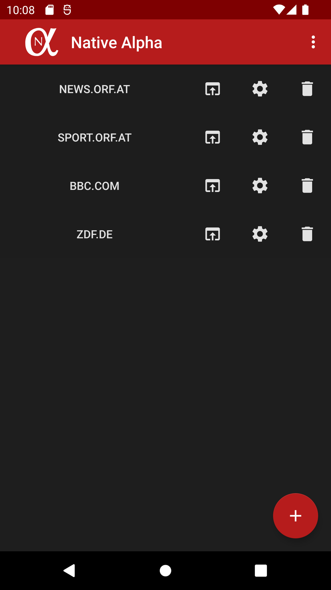
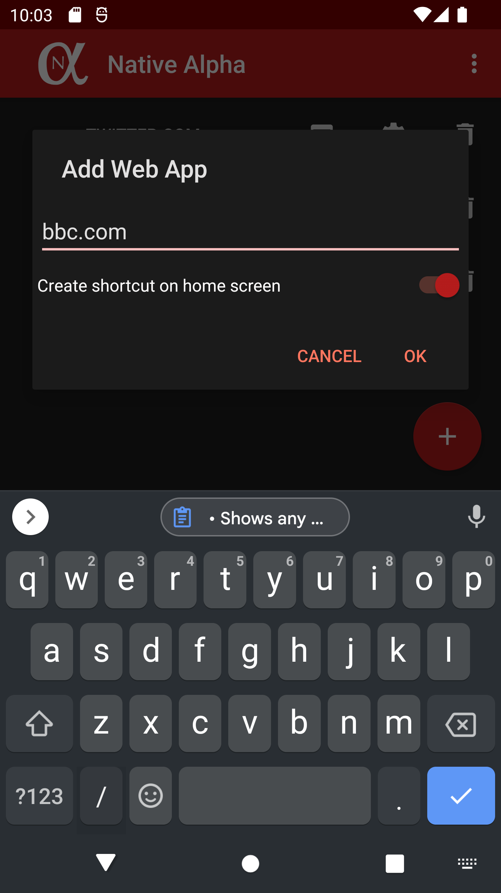
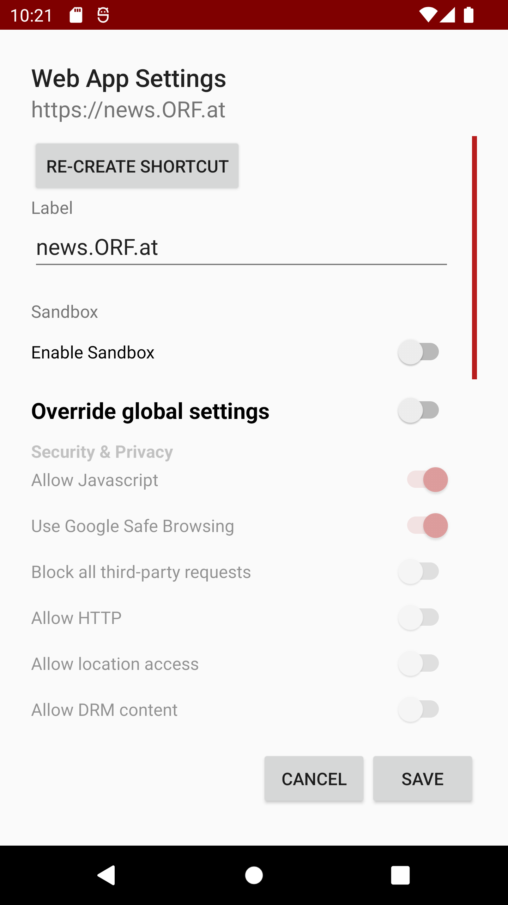
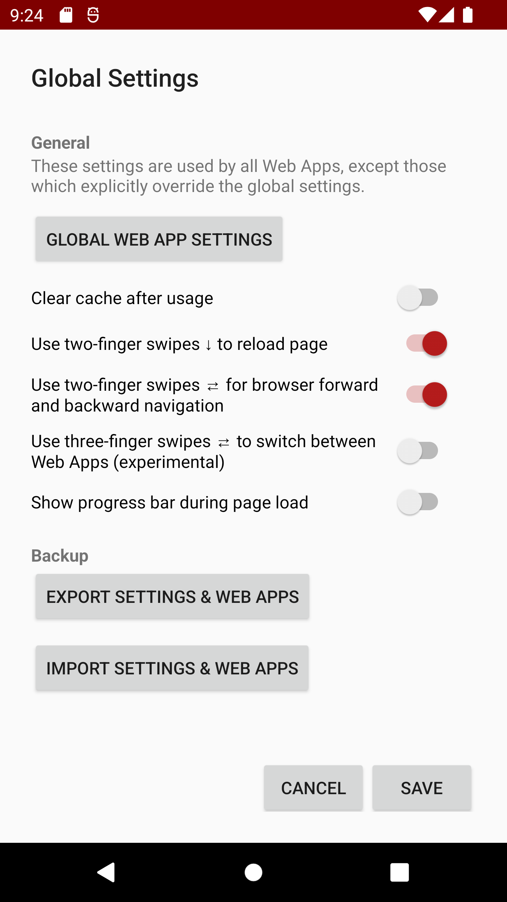

#  Native Alpha

[](https://github.com/JoestarLabs/NativeAlpha/releases)
[](https://developer.android.com)
[](https://developer.android.com)

**Native Alpha** turns web applications and websites into distraction-free, borderless, full-screen native Android applications powered by Android System WebView.

Run your favorite web services with granular privacy controls, ad blocking, custom home screen shortcuts, and an edge-to-edge Material 3 experience.

---

## Features

- **Borderless Full-Screen**: Native, distraction-free web browsing with customizable navigation gestures.
- **Granular Privacy & Permissions**: Configure JavaScript, cookies, location, camera, and microphone per web app.
- **Integrated Ad Blocking**: Flexible ad-blocking engine with support for custom filter lists.
- **Material 3 Design**: Clean, modern interface supporting dynamic system dark mode and edge-to-edge layouts.
- **Shortcuts & Custom Icons**: Add web apps to the home screen with high-resolution icon caching and SVG support.
- **Sandboxed Sessions**: Keep web app data and cookies isolated across distinct sandboxed containers.
- **Biometric Protection**: Lock sensitive web apps with fingerprint or lockscreen PIN authentication.
- **16 KB Page Alignment**: Native C++ adblock engine built with NDK r28c, fully aligned for Android 15+ 16 KB page size devices.
- **Lightweight & Transparent**: Zero background bloatware, telemetry, or analytics.

---

## Download

> [!IMPORTANT]
> **Migrating from upstream Native Alpha**: Due to a new release signing key, this build cannot be installed directly over the upstream version. Please export a backup of your web apps and settings via **Settings → Backup & Restore** in the old app first, then restore the file after installing this build.

### Install via Obtainium

Recommended for automated background updates directly from GitHub releases:

<a href="https://apps.obtainium.imranr.dev/redirect?r=obtainium://add/https://github.com/JoestarLabs/NativeAlpha/releases">
  
</a>

### GitHub Releases

Download release APKs directly from the [GitHub Releases](https://github.com/JoestarLabs/NativeAlpha/releases) page:

- **Universal APK**: Compatible with all devices (recommended for most users).
- **ARM64 APK** (`arm64-v8a`): Optimized build for modern 64-bit devices.

---

## Screenshots

<details>
<summary><b>Click to expand screenshots</b></summary>
<br>
<div align="center">
  
  
  
  
</div>
</details>

---

## FAQ

<details> 
<summary><b>Why use Native Alpha over a mobile browser?</b></summary>
<br>
Standard mobile browsers typically only offer fullscreen shortcuts if a website explicitly supplies a Progressive Web App (PWA) manifest. Native Alpha gives <i>every</i> website a native, borderless container while allowing independent permissions, cache controls, and adblock configurations per site.
</details>

<details> 
<summary><b>Does Native Alpha use its own browser engine?</b></summary>
<br>
No. Native Alpha runs on top of the built-in Android System WebView (Chromium). Keep your device's System WebView updated to benefit from the latest web standards, performance, and security fixes.
</details>

<details> 
<summary><b>Can I maintain separate logins for the same site?</b></summary>
<br>
Yes. Native Alpha supports sandboxed containers that isolate cookies, storage, and sessions across different instances of the same service.
</details>

<details> 
<summary><b>How are website icons retrieved?</b></summary>
<br>
Native Alpha probes the site's manifest, apple-touch-icon, and favicon tags (including SVG favicons) to find the highest available resolution. Custom icons can also be applied.
</details>

---

## Building from Source

### Prerequisites
- Android SDK (API Level 37.2)
- Android NDK (r28+) & CMake (3.22.1+)
- JDK 25
- Gradle 9.9+ (included wrapper)

### Build Debug APK
```bash
./gradlew assembleStandardDebug
```

### Build Release APK
```bash
./gradlew assembleStandardRelease
```

### Run Formatting, Unit Tests & Lint
```bash
./gradlew spotlessCheck testStandardDebugUnitTest lintStandardDebug
```

### 16 KB Page Size Compatibility
Native Alpha compiles its native C++ adblock engine (`:adblock-client`, sourced from [Edsuns/AdblockAndroid](https://github.com/Edsuns/AdblockAndroid)) directly from source using CMake and modern NDK r28c with flexible page size flags (`-DANDROID_SUPPORT_FLEXIBLE_PAGE_SIZES=ON` and `-Wl,-z,max-page-size=16384`). All 64-bit ELF binaries (`arm64-v8a` and `x86_64`) have their `LOAD` segments aligned at 16 KB boundaries, satisfying Google Play and Android 15+ requirements.

---

## Upstream & Credits

- **Native Alpha**: Originally designed and built by [cylonid](https://github.com/cylonid) in [NativeAlphaForAndroid](https://github.com/cylonid/NativeAlphaForAndroid). This repository is a modernized continuation maintained under [JoestarLabs](https://github.com/JoestarLabs). We are deeply grateful to the original author for the foundational project and open-source work.
- **Adblock Engine (`:adblock-client`)**: Sourced from [Edsuns/AdblockAndroid](https://github.com/Edsuns/AdblockAndroid), adapting [Brave's ad-block](https://github.com/brave/ad-block) C++ engine and [DuckDuckGo Android](https://github.com/duckduckgo/Android) bindings for Android WebView. Modernized here to build from source with modern NDK r28c and 16 KB page-size support.

---

## License

Native Alpha is Free and Open Source Software licensed under the [GNU General Public License v3.0](LICENSE).
